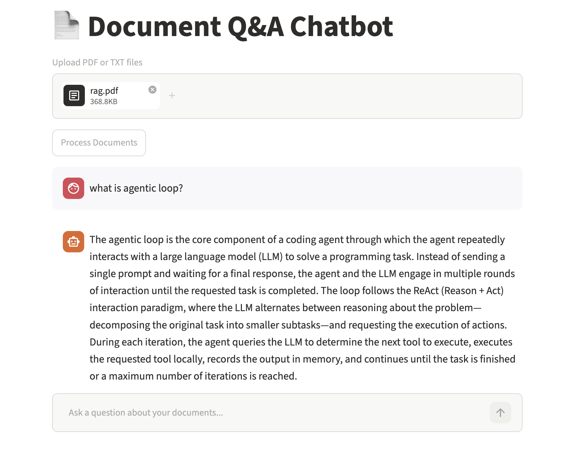

## Simple Rag Chatbot built with Langchain, Chromadb, OpenAI and Streamlit

### Local Configuration
`
git clone https://github.com/shihabhasan0161/simplerag.git
cd simplerag
` 
`
python -m venv venv
` 
`
source venv/bin/activate
` 
`
pip install -r requirements.txt
` 
` streamlit run app.py
` 

Demo: 
